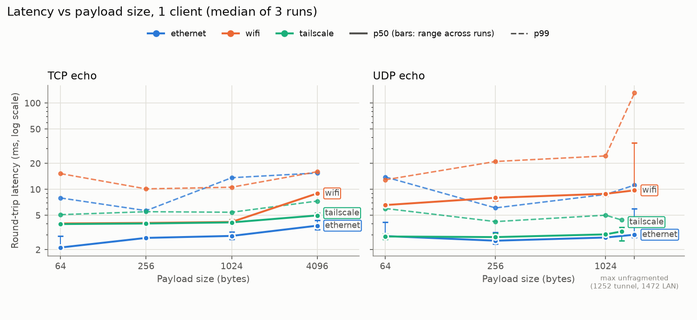
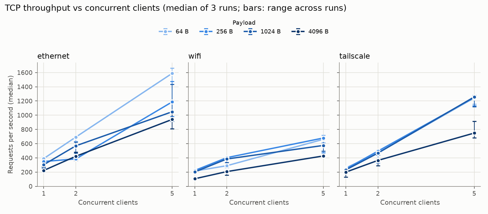

# Results

Measured 11 November 2026 on the setup in [pi-environment.md](pi-environment.md). Raw
data: [`benchmarks/results/`](../benchmarks/results/). Every number below comes from those
CSVs; matrix figures are the **median of 3 runs** unless stated.

## Summary

- **All acceptance tests passed.** 297,000 matrix TCP requests across three network paths
  returned 0 errors and 0 corrupted echoes. The 1,000,000-request stability run returned
  0 errors, and server memory stayed flat at 3.4 MB.
- **The loss counter is accurate.** With 5 % loss injected by `tc netem`, the client
  measured **4.96 %** (496 of 10,000).
- **Most of the latency is the network, not the server.** Even the best path has a median
  round trip of about 2.1–2.6 ms, and the laptop's own Wi-Fi hop is in every path.
- **The single-threaded server does not limit throughput up to 5 clients.** With 5 clients
  and 64 B payloads, throughput rises 4.1× over Ethernet and 4.8× over Tailscale. One
  client waits for each reply, so it is limited by round-trip time, and more clients fill
  that idle time.
- **Moving the Pi from Ethernet to Wi-Fi costs about 1.3–1.9 ms at the median.** It also
  roughly halves 5-client throughput and is the only path that lost UDP datagrams.

## Test setup

| Item | Value |
|---|---|
| Server | Raspberry Pi 3B+, Pi OS Lite 64-bit (Trixie), kernel 6.18.50, `nda-server` C++17 under systemd |
| Client | Windows 11 laptop, Python 3.14.6, **connected over Wi-Fi in every test** |
| Router | Home router; laptop and Pi on the same /24 subnet |
| Requests per configuration | 1,000 (matrix), 10,000 (acceptance), 1,000,000 (stability) |
| UDP pacing | 1 datagram per ms (offered load ~1,000/s) |

The three paths differ only in how the Pi reaches the router:

| Label in the CSVs | Path | Pi address used |
|---|---|---|
| `ethernet` | laptop Wi-Fi → router → **Pi Ethernet** (Pi Wi-Fi radio off) | 192.168.1.180 |
| `wifi` | laptop Wi-Fi → router → **Pi Wi-Fi** 5 GHz ch 157, −18 dBm, power save on (Pi Ethernet disconnected) | 192.168.1.177 |
| `tailscale` | laptop Wi-Fi → router → Pi Ethernet, **inside a WireGuard tunnel** (direct, not relayed) | `nda-pi` (100.70.239.49) |

Only one Pi interface was up per run. Both interfaces sit on the same subnet, so with
both up, Linux would send replies through whichever route has the lower metric,
regardless of the address the laptop targeted.

## Acceptance tests (plan section 5)

| Test | Procedure | Result | Pass |
|---|---|---|---|
| TCP reliability | 10,000 sequential echo requests | 10,000 / 10,000 valid, p50 3.02 ms | Yes |
| TCP correctness | Malformed JSON, invalid UTF-8, unknown command, bad args, oversize frame, half frame then disconnect | Every case gets its documented error code or a clean close; the server keeps serving. Automated in `client/tests/test_integration.py`, which runs against the real binary in CI with AddressSanitizer. | Yes (CI, not on the Pi) |
| UDP delivery | 10,000 sequenced datagrams | 10,000 / 10,000, 0 lost, 0 reordered | Yes |
| UDP loss accuracy | 10,000 datagrams with `netem loss 5%` on the Pi | **4.96 %** measured. Expected 5 % ± 0.22 % (1 standard deviation for 10,000 trials) | Yes |
| Latency | 1,000 pings, 3 runs per path | Ethernet p50 2.56 / p95 4.06 / p99 5.74 ms (table below) | Yes |
| Throughput | 4 payload sizes × 1, 2, 5 clients | Reported as msg/s and bytes/s for every configuration | Yes |
| Concurrency | 5 simultaneous clients | 180,000 requests across 36 five-client runs, all echoes matched | Yes |
| Recovery | `systemctl restart nda-server` during a 3,000-ping session | Client exited with `connection error: … server closed the connection`, no hang | Yes |
| Stability | Continuous load | **35.4 min**, 1,000,000 / 1,000,000, p50 2.00 ms, p99 3.15 ms. Server RSS 3,240 → 3,444 kB at first connection, then constant across 45 one-minute samples | Yes (35 min instead of 1 h, see deviations) |

## Latency

Single client, 64 B TCP echo and the bare `ping` command (median of 3 runs; the range
across runs is in brackets).

| Path | ping p50 | ping p95 | ping p99 | echo 64 B p50 | echo 4 KiB p50 | worst single request |
|---|---|---|---|---|---|---|
| ethernet | 2.56 ms | 4.06 | 5.74 | 2.12 [2.09–2.88] | 3.80 [3.40–4.39] | 226 ms |
| wifi | 3.90 ms | 6.70 | 10.02 | 4.03 [3.99–4.12] | 8.98 [8.95–9.05] | 352 ms |
| tailscale | 3.96 ms | 4.44 | 5.00 | 3.96 [3.94–4.06] | 4.99 [4.94–5.36] | 133 ms |



UDP echo, single client, at the offered load of about 1,000 datagrams/s:

| Path | 64 B p50 | 1024 B p50 | max size p50 | sent | lost | sender errors | reordered |
|---|---|---|---|---|---|---|---|
| ethernet | 2.88 ms | 2.77 | 2.98 (1472 B) | 12,000 | 0 | 0 | 2 |
| wifi | 6.58 ms | 8.89 | 9.75 (1472 B) | 12,000 | 5 | 2 | 18 |
| tailscale | 2.85 ms | 3.01 | 3.26 (1252 B) | 12,000 | 0 | 0 | 0 |

## Throughput

TCP requests per second, median of 3 runs.

| Path | Payload | 1 client | 2 clients | 5 clients | 5 ÷ 1 | payload MB/s at 5 |
|---|---|---|---|---|---|---|
| ethernet | 64 B | 390 | 693 | 1,590 | 4.1× | 0.10 |
| | 256 B | 349 | 385 | 1,188 | 3.4× | 0.30 |
| | 1 KiB | 304 | 570 | 1,049 | 3.5× | 1.07 |
| | 4 KiB | 223 | 422 | 941 | 4.2× | 3.85 |
| wifi | 64 B | 215 | 290 | 661 | 3.1× | 0.04 |
| | 256 B | 222 | 403 | 679 | 3.1× | 0.17 |
| | 1 KiB | 202 | 384 | 574 | 2.8× | 0.59 |
| | 4 KiB | 106 | 207 | 427 | 4.0× | 1.75 |
| tailscale | 64 B | 257 | 471 | 1,243 | 4.8× | 0.08 |
| | 256 B | 243 | 495 | 1,248 | 5.1× | 0.32 |
| | 1 KiB | 231 | 467 | 1,257 | 5.4× | 1.29 |
| | 4 KiB | 199 | 364 | 749 | 3.8× | 3.07 |



UDP msg/s is not in this table on purpose. It equals the client's sending rate
(~1,000/s), not the server's capacity; see [architecture.md](architecture.md#measurement-notes).

## Discussion

**Every path includes a Wi-Fi hop.** The laptop was on Wi-Fi for every test, so even the
`ethernet` path crosses the laptop's radio. Wired-to-wired round trips on a LAN are usually
well under 1 ms. The ~2.1–2.6 ms floor here is mostly the laptop's Wi-Fi, so the
Ethernet-vs-Wi-Fi comparison isolates **the Pi's link only**. A USB Ethernet adapter on the
laptop would give the true wired baseline.

**What the Pi's Wi-Fi costs.** Compared with the Pi on Ethernet:
- the median rises by about 1.3 ms (ping) to 1.9 ms (64 B echo);
- p99 roughly doubles;
- 5-client throughput falls to 42–57 %.

Two wireless hops share the same airtime, and the Pi's power save was on. The jump at
4 KiB (4.19 → 8.98 ms, about 2.1×) appears only on this path. A 4 KiB echo is about three
TCP segments each way, and every segment crosses two radios.

**UDP is slower than TCP on Wi-Fi, but that reflects load, not the protocol.** The TCP
latency tests keep one request in flight. The UDP test sends ~1,000 datagrams/s
continuously, which builds a queue at the radios. That explains why the UDP medians on
Wi-Fi (6.6–9.8 ms) are about twice the TCP medians, while on Ethernet the two are within
about 0.5 ms. It is
also the only path with loss: 5 datagrams lost, 18 reordered within one run, and 2
datagrams the laptop's network stack refused to send. Those 2 are counted as sender
errors, not as network loss.

**Reordering on a home LAN.** UDP gives no ordering guarantee, and the counter shows it:
2 out-of-order arrivals out of 12,000 even on the Ethernet path, and 18 in a single Wi-Fi
run.

**Tailscale: higher median for TCP, not for UDP.** Through the tunnel:
- TCP's median is about 1.4–1.8 ms higher than direct Ethernet (3.96 vs 2.12–2.56 ms).
- UDP's median is unchanged (2.85 vs 2.88 ms).
- The tail is *tighter* (ping p99 5.0 vs 5.7 ms).
- 5-client throughput is flat at ~1,250 msg/s from 64 B to 1 KiB, beating direct Ethernet
  at 256 B and 1 KiB.

**We have not explained** why the extra latency affects TCP but not UDP. Encryption cost
alone would add the same amount to both. Plausible causes are the Windows Tailscale
client's packet handling or how TCP acknowledgements interact with the tunnel. A packet
capture on both ends would settle it. Tailscale run 1 was also measured about 85 minutes
before runs 2–3. Its p99 was higher (7.2 vs 5.0 ms), but its median agreed within 0.1 ms.

**Tail latency comes from occasional 100–350 ms stalls.** Every one of the 9 matrix runs
had at least one configuration whose slowest request exceeded 100 ms. Of the 31 such
configurations, 23 had 2 or 5 clients. The stalls also cluster in time: in Ethernet run 1,
five consecutive configurations each hit a 125–138 ms maximum within the same 20 seconds.
The worst requests were 226 ms (Ethernet), 352 ms (Wi-Fi) and 133 ms (Tailscale).
Wi-Fi retransmissions, background scans or power-save wake-ups on either radio are
plausible causes; they were not isolated. Because each run catches a different set of
stalls, p99 varies a lot between runs (Ethernet 64 B p99 ranged 5.7–16.0 ms), so the
charts use the median of 3 runs.

**Scaling with clients.** Throughput grows almost linearly with clients because one
client is limited by round-trip time. At ~2.5–4 ms per round trip, one client can do at
most ~250–400 requests/s however fast the server is. Server CPU was not recorded during
the matrix, so these results show the single-threaded design is **not the bottleneck up
to 5 clients**. They do not show where its limit is. The weakest scaling (wifi 1 KiB,
2.8×) is on the path where the clients share a radio, which points at the network rather
than the server.

**Memory.** The server's resident memory was 3.4 MB for the whole stability run. It grew
by 204 kB once, when the first client connected and the socket buffers were allocated,
and never changed after that. The systemd `MemoryMax=64M` limit in
`deploy/nda-server.service` is **not enforced on this Pi**: the stock Raspberry Pi kernel
disables the memory cgroup (`/sys/fs/cgroup/cgroup.controllers` lists only
`cpuset cpu io pids`), so memory was verified by sampling `VmRSS` instead.

## Deviations from the project plan

| Plan | What was done | Why |
|---|---|---|
| Python server | C++17 server, Python client | Shows non-blocking I/O, framing and memory behaviour on the embedded side ([decision 001](decisions/001-cpp-server-python-client.md)) |
| Newline-delimited JSON | 4-byte length prefix + JSON | Oversize messages can be rejected from the header; partial reads are explicit ([decision 002](decisions/002-length-prefixed-framing.md)) |
| UDP at 4 KiB | UDP capped at 1472 B (LAN) / 1252 B (tunnel) | Larger datagrams are IP-fragmented, which measures kernel reassembly rather than the protocol |
| Stability: 1 hour | 35.4 minutes (1,000,000 requests) | Link ran faster than estimated; judged sufficient with the memory log |
| Wi-Fi first, Ethernet if available | Both, plus a Tailscale tunnel | Third path quantifies tunnel overhead and enables remote access ([remote-access.md](remote-access.md)) |
| No web dashboard | One read-only status page, laptop-side | Demo convenience; the Pi server is unchanged ([decision 003](decisions/003-laptop-side-status-page.md)) |
| TCP correctness on the Pi | Automated in CI against the same source | The malformed-input tests start their own server binary; they were not pointed at the Pi |

## Limits of these results

- The laptop is on Wi-Fi for every path (see above).
- One laptop generates all client load with Python threads. Python runs only one thread's
  code at a time, so the client itself may cap the 5-client numbers. Server CPU was not
  sampled.
- One evening, one home network, three runs per path. Treat the medians as typical of
  this setup, not as general Pi 3B+ capabilities.
- Pi Wi-Fi power save was on, and the band was recorded after the runs (same router, same
  configuration).

## Reproduce

```powershell
nda --host 192.168.1.180 bench matrix --link ethernet  --out benchmarks/results/ethernet.csv   # x3
nda --host 192.168.1.177 bench matrix --link wifi      --out benchmarks/results/wifi.csv       # x3
nda --host nda-pi        bench matrix --link tailscale --out benchmarks/results/tailscale.csv  # x3
nda plot benchmarks/results/ethernet.csv benchmarks/results/wifi.csv benchmarks/results/tailscale.csv
```

Full procedure, including which Pi interface to disable for each run:
[pi-bringup.md](pi-bringup.md) and [remote-access.md](remote-access.md).
